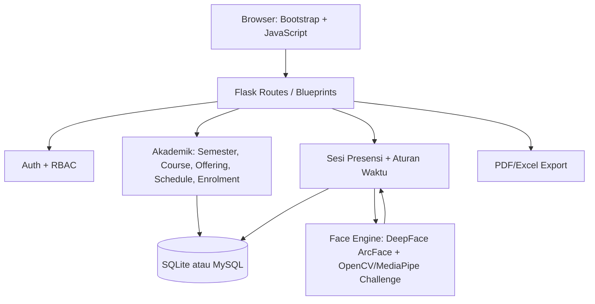
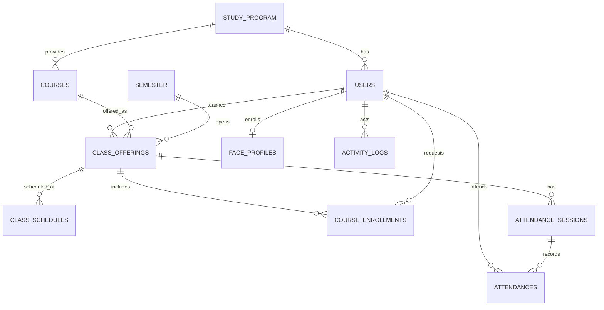

# Arsitektur Sistem

## Relasi konseptual

## Endpoint penting
- `POST /student/api/face/enroll` — pendaftaran Face Profile setelah login, dengan challenge sampel depan/kedip/kiri/kanan.
- `POST /student/api/attendance/<session_id>/verify` — pemeriksaan blink, face embedding, token, enrolmen APPROVED, sesi, jendela waktu, dan duplikasi.
- Route sesi dosen membuat kode pendek serta token acak panjang untuk QR.

## Prinsip keamanan
1. Backend memvalidasi semua hak presensi, bukan hanya frontend.
2. Enrolmen `APPROVED` diperlukan untuk jadwal dan hak presensi.
3. Face engine memverifikasi identitas; backend menentukan apakah presensi diperbolehkan.
4. Unique constraint pada `(session_id, student_id)` mencegah presensi ganda.
5. Sesi yang kedaluwarsa ditutup pada permintaan terautentikasi berikutnya dan peserta yang belum tercatat difinalisasi `ABSENT`.
6. Challenge kedip/gerak kepala berbasis sampel adalah mitigasi dasar; tidak menjamin penolakan semua serangan foto/video.
7. Data biometrik diperlakukan sebagai data sensitif dan harus dilindungi dengan dasar pemrosesan, persetujuan dan retensi yang sesuai.
